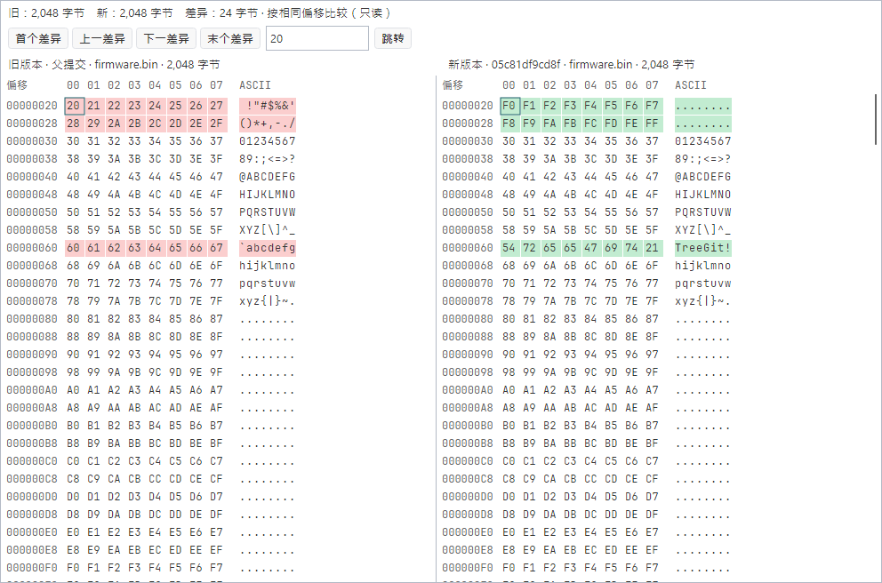
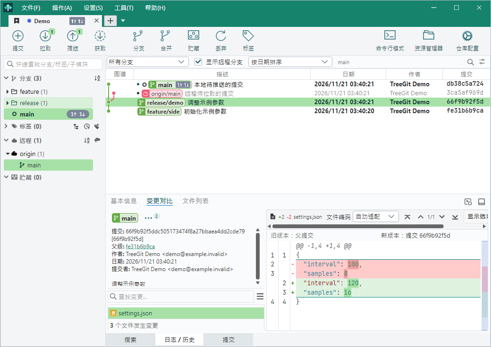
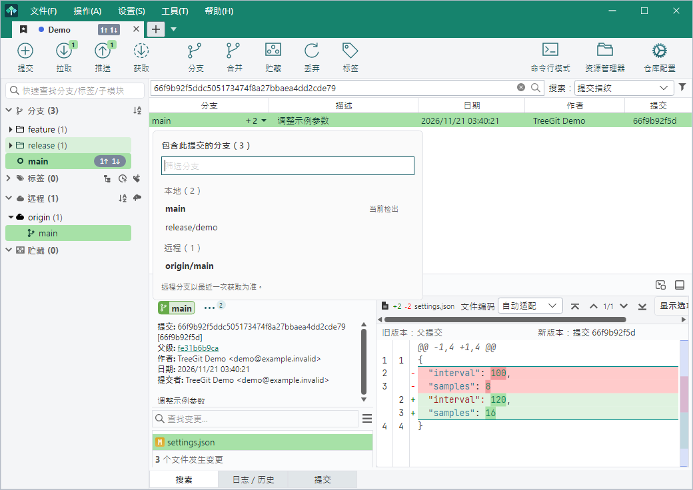
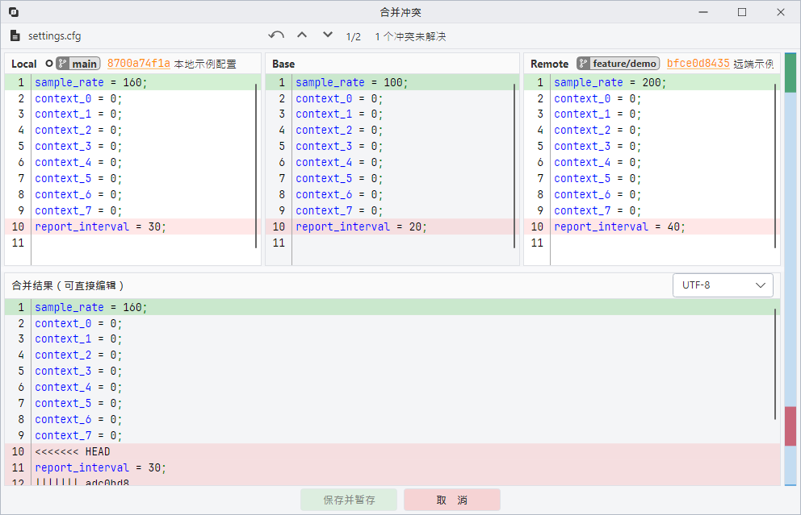

# TreeGit

面向工程师的 Windows 便携 Git 客户端。基于 [SourceGit](https://github.com/sourcegit-scm/sourcegit)，保留完整 Git 工作流，优化常用操作的界面布局。

## 特点

- **内置二进制对比**　固件和其他二进制文件可左右查看十六进制和 ASCII，突出变化字节，按偏移跳转，无需外部工具。
- **提交与分支联动**　选中提交，侧栏用深浅底色区分对应分支、跟踪分支和其他包含该提交的分支。搜索结果也能直接展开包含分支列表。
- **文本对比和冲突编辑**　混合编码文本可逐行识别 UTF-8 或 GB2312；合并冲突时可并排查看 Local、Base、Remote，逐块取舍或直接编辑结果，再保存并暂存。
- **MCP 读写**　AI 可搜索提交、查看差异、操作界面并执行 Git 命令。也可配置只读连接。

## 界面

截图来自 2026.24.11 的 Windows 便携版，使用虚构仓库。点击图片可查看原图。

| 固件字节变化与偏移跳转 | 选中提交后高亮对应分支 |
| --- | --- |
|  |  |
| **展开搜索结果的包含分支** | **三方对照并编辑合并结果** |
|  |  |

[查看同一文件内不同编码的中文差异](docs/images/ui-2026.24.11/text-comparison.png)

## 下载与使用

下载 [TreeGit 2026.24.12 · Windows x64](https://github.com/JonSun2020/TreeGit/releases/download/treegit-v2026.24.12/TreeGit-2026.24.12-Windows-x64.zip)，解压后运行 `TreeGit/TreeGit.exe`。便携包包含 Git 和运行时，优先使用本机 Git。校验值见 [Releases](https://github.com/JonSun2020/TreeGit/releases/latest)。现有用户可通过“帮助 → 检查更新”升级。

AI 连接：在“工具 → MCP · AI 连接”复制配置。详见 [MCP 使用说明](docs/MCP.md)。

[完整功能与入口](docs/FUNCTIONALITY.md) · [便携版与构建说明](docs/PORTABLE.md) · [发行说明](docs/RELEASE-2026.24.12.md)

## 开源与维护

基于 SourceGit 2026.24，持续跟随上游正式版本迭代，保留 TreeGit 自行开发的功能与交互；维护方式见 [上游同步说明](docs/UPSTREAM.md)。

遵循 [MIT 许可证](LICENSE)，保留 SourceGit 原版权及 [第三方声明](THIRD-PARTY-LICENSES.md)。欢迎通过 Issues 或 Pull Request 反馈与改进。
