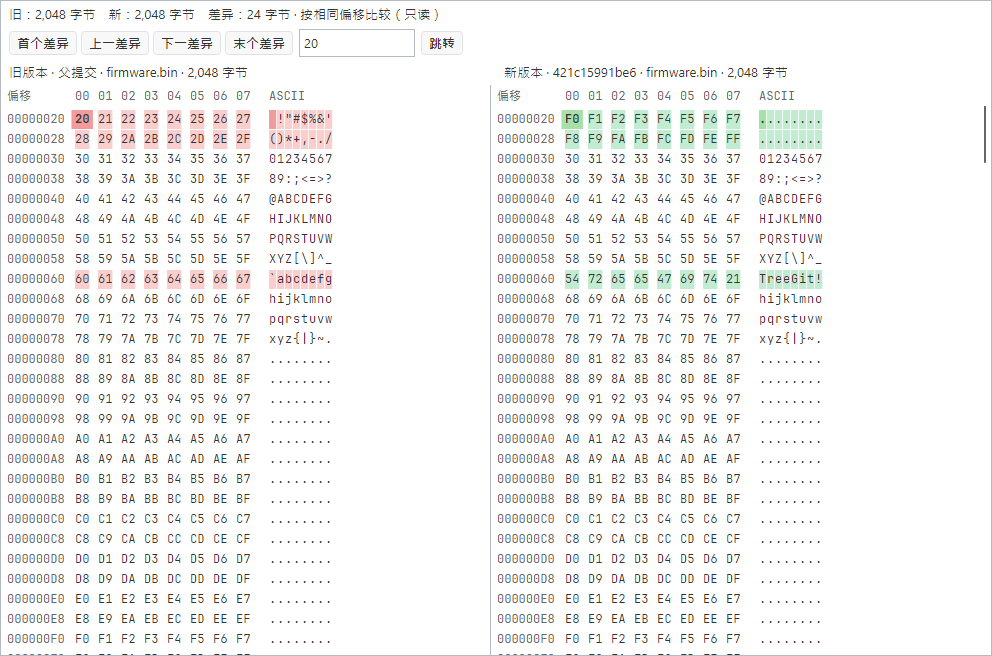
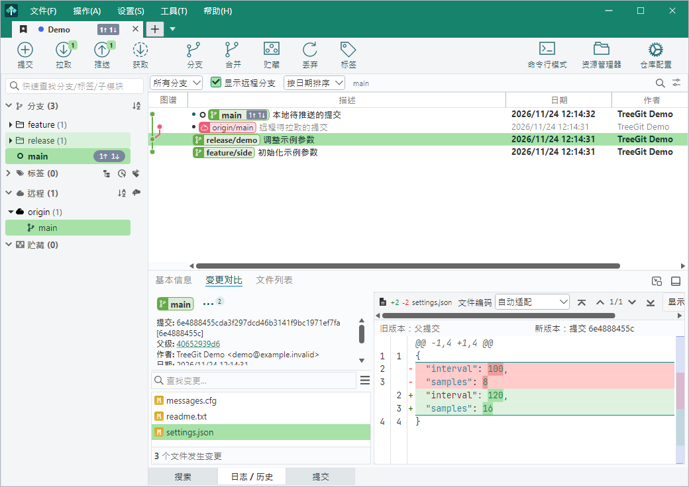
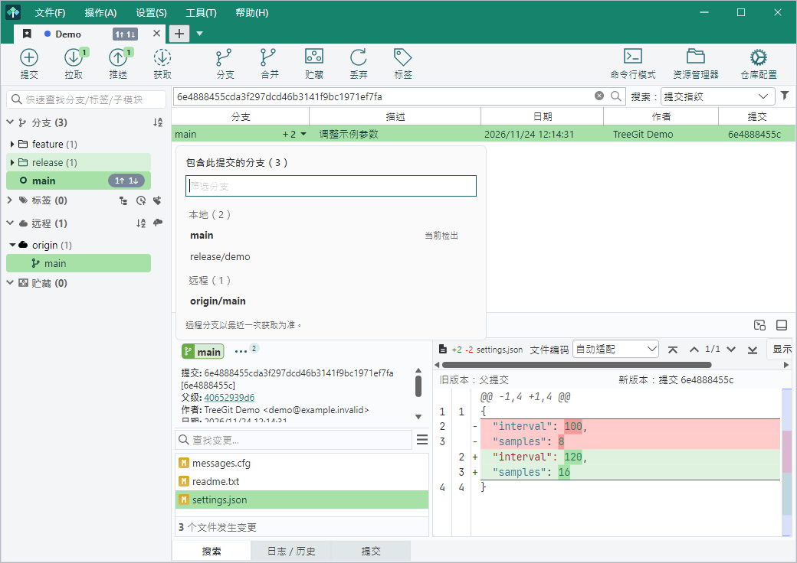
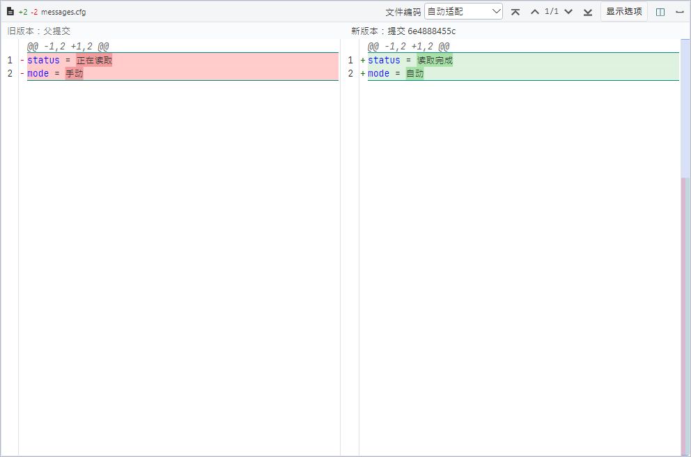
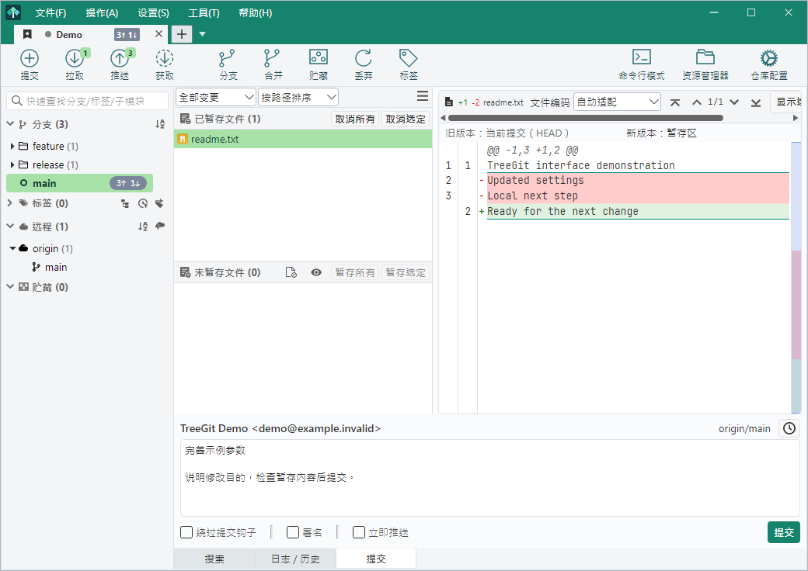

# TreeGit

TreeGit 是面向工程师的 Windows 便携 Git 客户端。用它查看固件每个变化字节，追踪提交对应的分支，并在提交前检查和处理文件差异。TreeGit 基于 [SourceGit](https://github.com/sourcegit-scm/sourcegit)，保留完整 Git 工作流。

## 特点

- **内置逐字节对比**　并排显示固件的十六进制和 ASCII，标出变化字节，支持按差异或输入偏移跳转。
- **提交与分支联动**　选中提交后，侧栏用深浅底色区分对应分支、跟踪分支和其他包含分支。搜索结果可以直接展开包含该提交的本地和远程分支。
- **混合编码文本对比**　在同一文件中逐行识别 UTF-8 或 GB2312，并排查看中文差异。
- **可编辑三方合并**　并排查看 Local、Base 和 Remote，逐块取舍或直接编辑合并结果，再保存并暂存。
- **提交与暂存**　在同一页面检查已暂存和未暂存文件、阅读差异和填写提交说明。不可用的暂存按钮会置灰。
- **MCP 读写和只读连接**　AI 可查询提交、读取差异和操作界面。读写连接也可执行 Git 命令。[MCP 使用说明](docs/MCP.md)

## 界面

截图来自 2026.24.15 的 Windows 便携版，使用虚构仓库。点击图片可查看原图。

| 固件字节变化与偏移跳转 | 选中提交后高亮对应分支 |
| --- | --- |
|  |  |
| **展开搜索结果的包含分支** | **三方对照并编辑合并结果** |
|  |  |
| **同一文件的混合编码中文差异** | **暂存状态、文件差异和提交说明** |
|  |  |

## 下载与使用

在 [GitHub Releases](https://github.com/JonSun2020/TreeGit/releases/latest) 选择 Windows x64 便携包，解压后运行 TreeGit/TreeGit.exe。

- **SystemGit** 适合已有可用 Git 的电脑。体积较小，使用电脑已安装的 Git。
- **BundledGit** 随包提供 Git，以及 OpenSSH 和 Git LFS 等组件。适合没有 Git、离线部署或需要修复内置 Git 的电脑。

两个压缩包的 SHA-256 均列在同一发行页的 SHA256SUMS.txt。新版可在“帮助 → 检查更新”自动选择需要的包。

AI 连接：在“工具 → MCP · AI 连接”复制配置。详见 [MCP 使用说明](docs/MCP.md)。

[完整功能与入口](docs/FUNCTIONALITY.md) · [便携版与构建说明](docs/PORTABLE.md) · [发行说明](docs/RELEASE-2026.24.16.md)

## 开源与维护

基于 SourceGit 2026.24，持续跟随上游正式版本迭代，保留 TreeGit 自行开发的功能与交互；维护方式见 [上游同步说明](docs/UPSTREAM.md)。

遵循 [MIT 许可证](LICENSE)，保留 SourceGit 原版权及 [第三方声明](THIRD-PARTY-LICENSES.md)。欢迎通过 Issues 或 Pull Request 反馈与改进。
