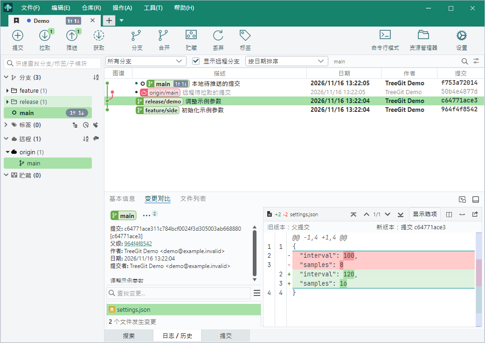
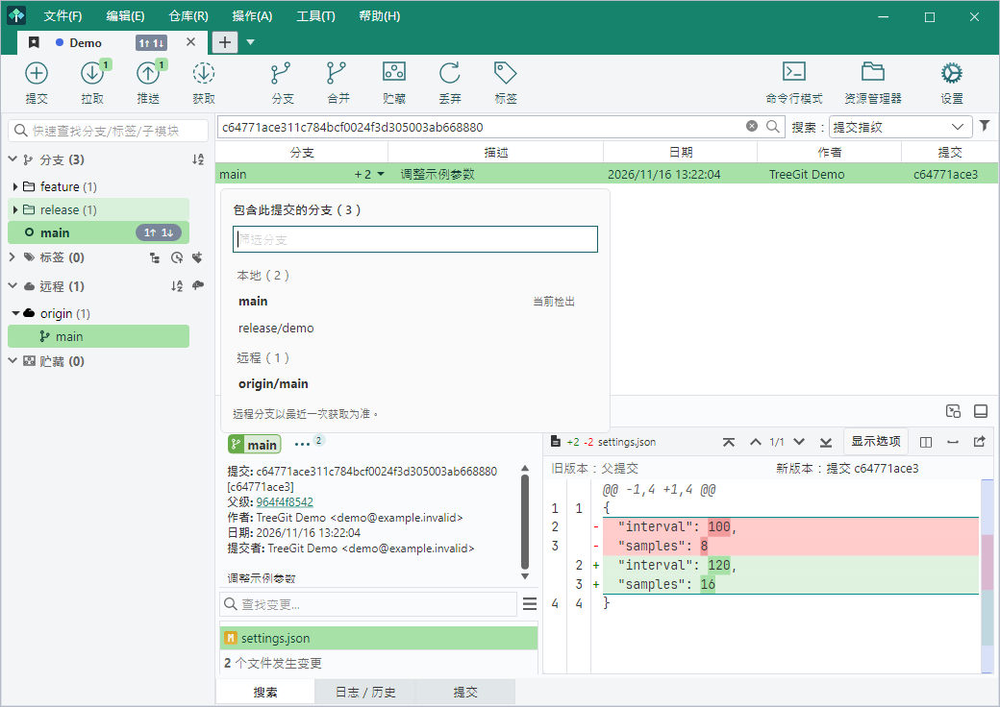
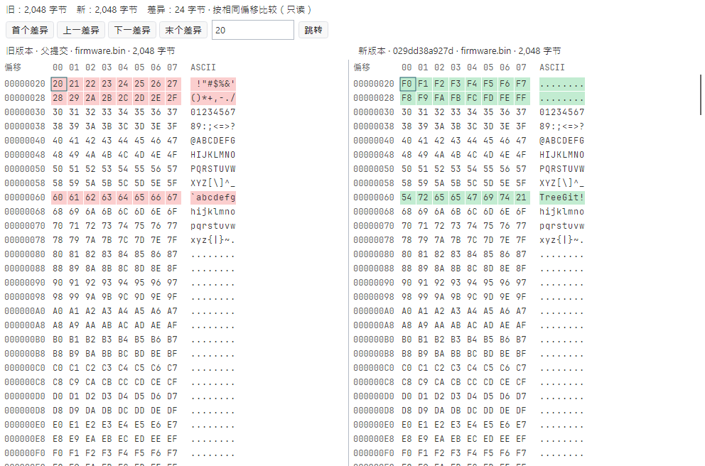
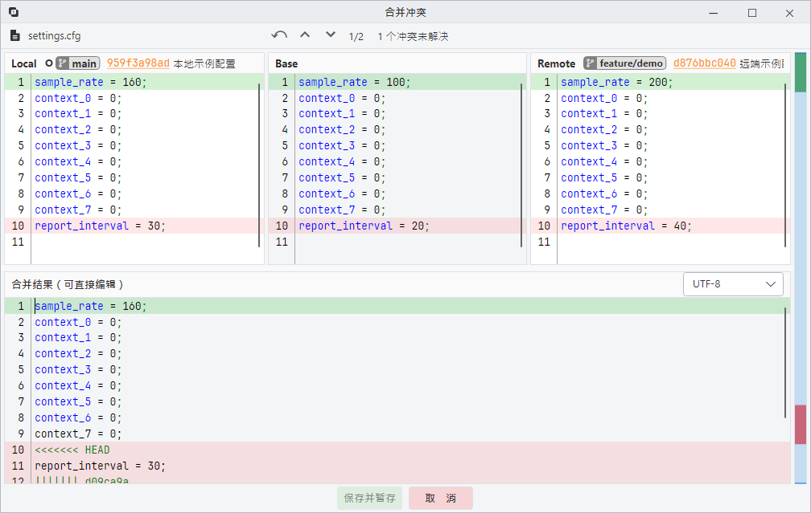
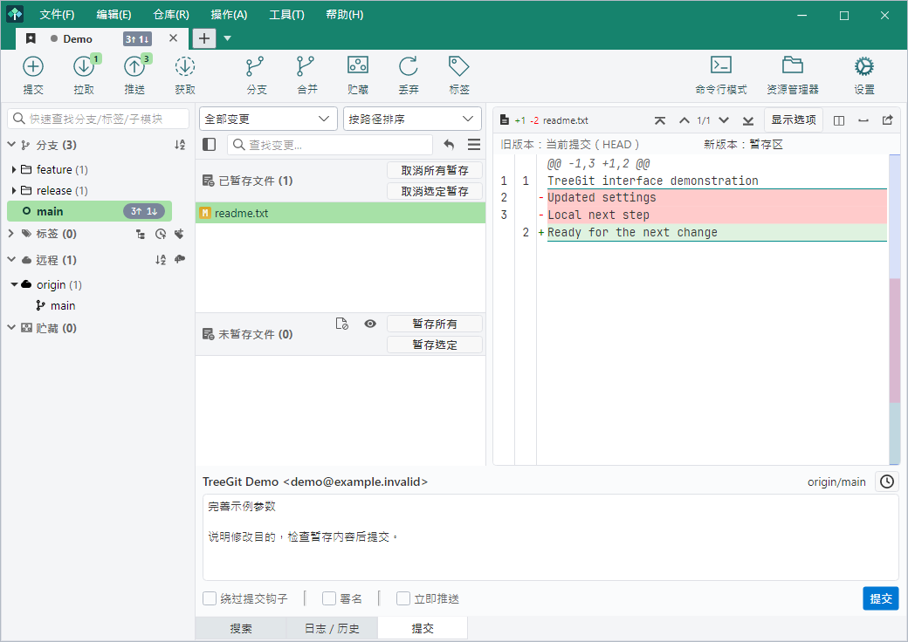
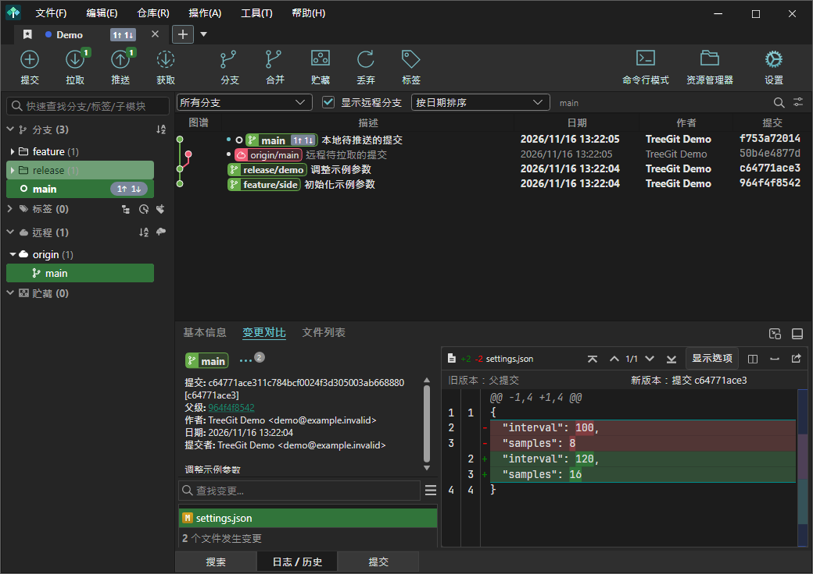

# TreeGit

面向工程师的便携 Git 客户端。基于 [SourceGit](https://github.com/sourcegit-scm/sourcegit)，保留完整 Git 工作流，围绕实际使用的便捷性、直观性优化界面布局。

**免安装、免登录软件账号，内置二进制对比，支持 MCP 让 AI 直接操作。**

## 特点

- **提交与分支联动**：选中提交或搜索结果，同时看清所有包含分支。本地分支及其跟踪远端同为深背景，其余为浅背景；收起的分组显示浅色提示，保留你的展开状态。
- **内置二进制对比**：左右查看十六进制、ASCII 和差异高亮，快速跳转差异与偏移；无需外部比较工具。
- **可编辑三方合并**：并排比较 Local / Base / Remote，直接编辑结果，逐块处理、复原或撤销，保存并暂存。
- **提交更直接**：账号、分支、暂存内容和提交选项集中展示；最近 10 条提交说明包含合并历史，点选插入光标处，无暂存文件时保护草稿并禁用提交。
- **MCP · AI 控制**：查询仓库、检索提交、查看差异、操作界面及执行 Git 操作；支持完整读写，也可使用只读连接。
- **简洁高效**：当前分支主线居左；切页保留提交与文件，搜索保留结果，分栏按仓库保存。支持三套主题、三种语言。
- **开箱即用**：自动使用系统 Git，缺失时使用随包 Git；支持 HTTPS/OpenSSL 与 OpenSSH、仓库独立认证，以及后台下载更新。

## 界面

真实界面截图，全部使用匿名演示数据。点击图片查看原图。

| 提交与分支联动 | 搜索与分支列表 |
| --- | --- |
|  |  |
| **内置二进制对比** | **可编辑三方合并** |
|  |  |
| **集中提交** | **Dark 主题** |
|  |  |

## 下载与使用

下载 [TreeGit 2026.24.5 · Windows x64](https://github.com/JonSun2020/TreeGit/releases/download/treegit-v2026.24.5/TreeGit-2026.24.5-Windows-x64.zip)，解压后运行 `TreeGit/TreeGit.exe`。包含 Git 与运行时，无需额外安装 .NET；校验值见 [Releases](https://github.com/JonSun2020/TreeGit/releases/latest)。现有用户可通过“帮助 → 检查更新”升级。

AI 连接：在“工具 → MCP · AI 连接”复制配置。详见 [MCP 使用说明](docs/MCP.md)。

[完整功能与入口](docs/FUNCTIONALITY.md) · [便携版与构建说明](docs/PORTABLE.md) · [发行说明](docs/RELEASE-2026.24.5.md)

## 开源与维护

基于 SourceGit 2026.24，持续跟随上游正式版本迭代，保留 TreeGit 自行开发的功能与交互；维护方式见 [上游同步说明](docs/UPSTREAM.md)。

遵循 [MIT 许可证](LICENSE)，保留 SourceGit 原版权及 [第三方声明](THIRD-PARTY-LICENSES.md)。欢迎通过 Issues 或 Pull Request 反馈与改进。
