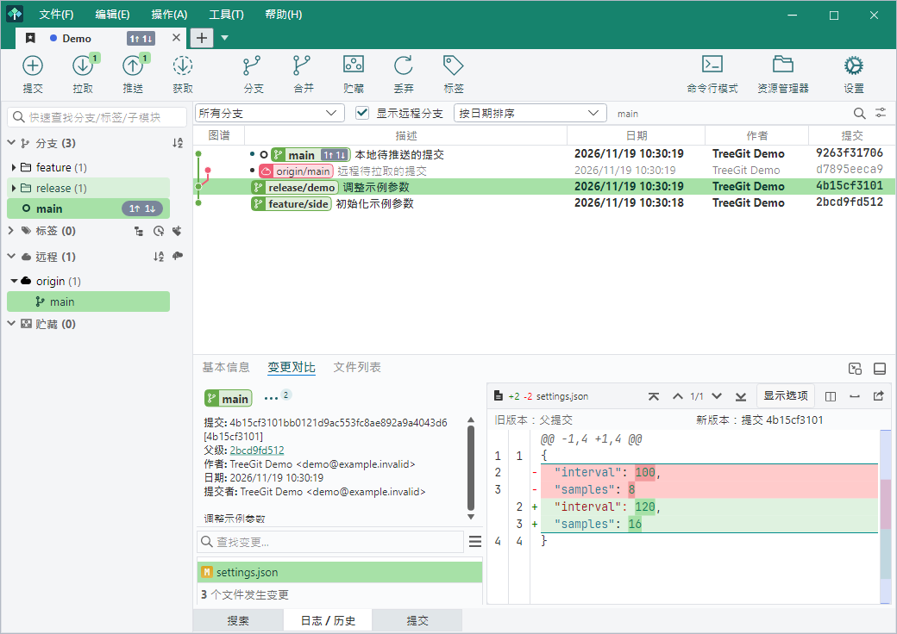
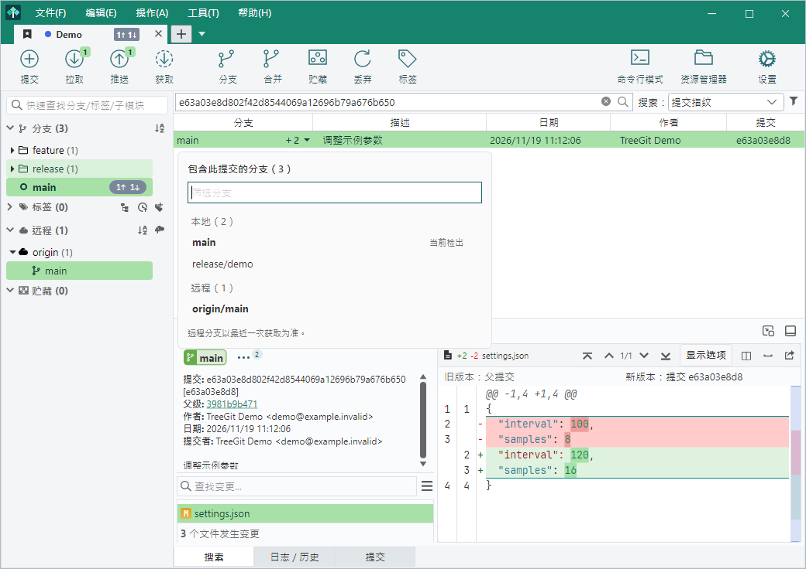
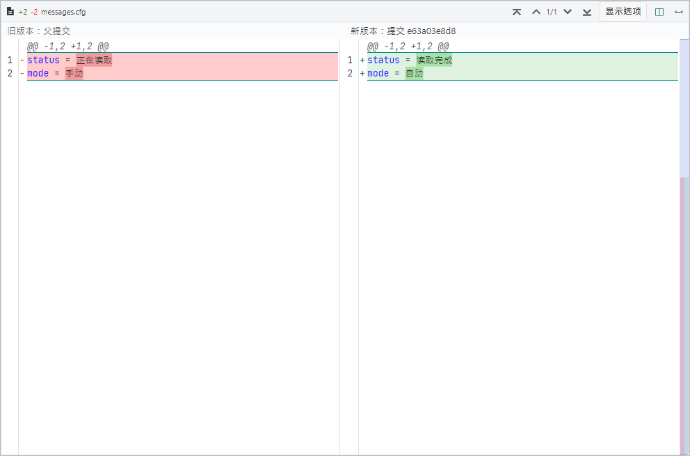
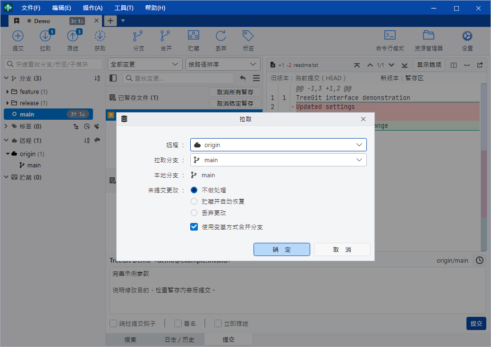
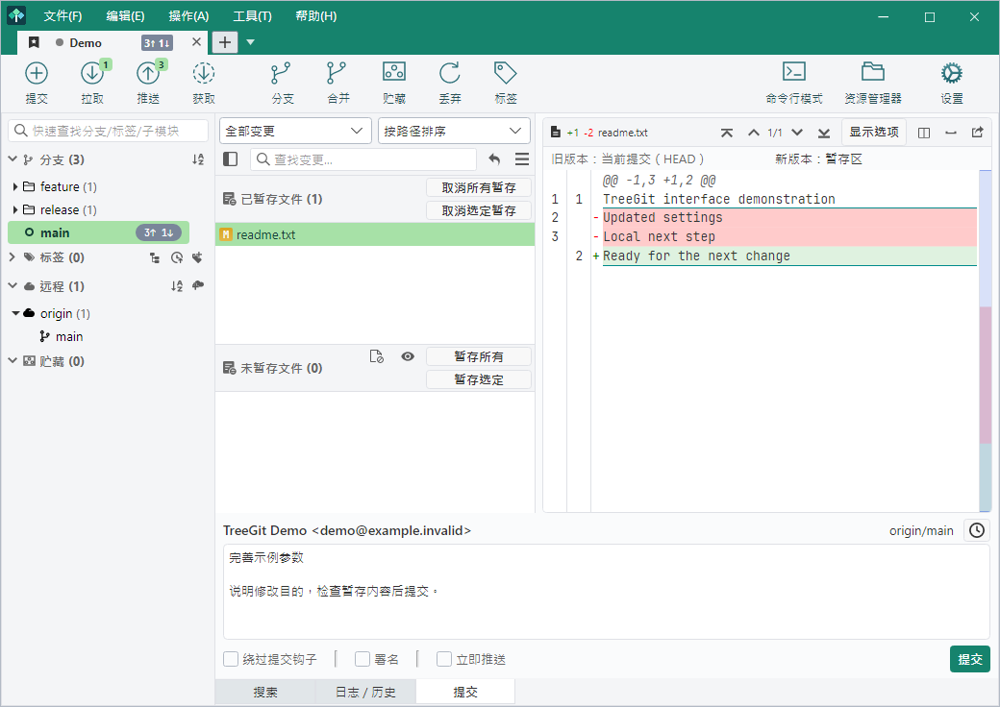
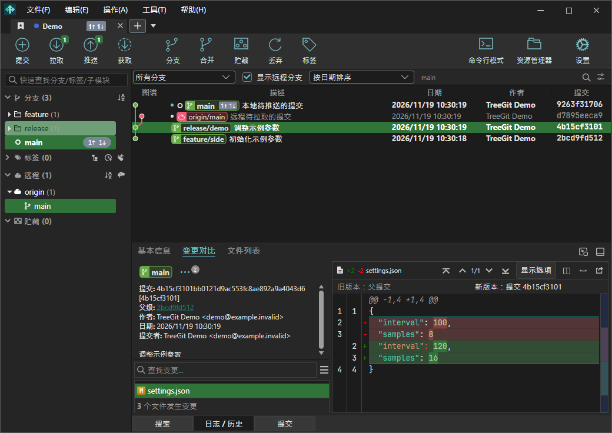

# TreeGit

面向工程师的便携 Git 客户端。基于 [SourceGit](https://github.com/sourcegit-scm/sourcegit)，保留完整 Git 工作流，围绕实际使用的便捷性、直观性优化界面布局。

**免安装的 Windows Git 客户端，内置二进制对比和三方合并，支持 AI 通过 MCP 读写仓库。**

## 特点

- **二进制和文本对比**　固件等二进制文件可以左右比较字节，按偏移跳转，无需外部工具。文本差异逐行识别 UTF-8 和 GB 系列编码，主界面和独立窗口分别保存布局。
- **提交与分支联动**　点击历史或搜索结果中的提交，左栏标出包含它的分支，深色标出对应分支及其本地或远端跟踪关系。
- **三方合并**　并排查看 Local、Base、Remote，逐块取舍、撤销或直接编辑结果，然后保存并暂存。
- **仓库与远端操作**　可同时创建本地仓库和 GitHub 远端，按仓库管理 HTTPS 账号。拉取、推送和获取可查看进度、取消操作、复制完整输出。
- **MCP 与便携运行**　AI 可检索提交、查看差异、操作界面和执行 Git 命令，支持只读连接。优先使用系统 Git，也可使用随包 Git，支持 HTTPS/OpenSSL 和 OpenSSH。

## 界面

以下截图来自 2026.24.6 的 Windows 便携版，全部使用虚构仓库。点击图片可查看原图。

| 提交与分支联动 | 搜索与分支列表 |
| --- | --- |
|  |  |
| **内置二进制对比** | **可编辑三方合并** |
|  |  |
| **不同编码的文本对比** | **Blue 主题下的拉取选项** |
|  |  |
| **集中提交** | **Dark 主题** |
|  |  |

## 下载与使用

下载 [TreeGit 2026.24.10 · Windows x64](https://github.com/JonSun2020/TreeGit/releases/download/treegit-v2026.24.10/TreeGit-2026.24.10-Windows-x64.zip)，解压后运行 `TreeGit/TreeGit.exe`。包含 Git 与运行时，无需额外安装 .NET；校验值见 [Releases](https://github.com/JonSun2020/TreeGit/releases/latest)。现有用户可通过“帮助 → 检查更新”升级。

AI 连接：在“工具 → MCP · AI 连接”复制配置。详见 [MCP 使用说明](docs/MCP.md)。

[完整功能与入口](docs/FUNCTIONALITY.md) · [便携版与构建说明](docs/PORTABLE.md) · [发行说明](docs/RELEASE-2026.24.10.md)

## 开源与维护

基于 SourceGit 2026.24，持续跟随上游正式版本迭代，保留 TreeGit 自行开发的功能与交互；维护方式见 [上游同步说明](docs/UPSTREAM.md)。

遵循 [MIT 许可证](LICENSE)，保留 SourceGit 原版权及 [第三方声明](THIRD-PARTY-LICENSES.md)。欢迎通过 Issues 或 Pull Request 反馈与改进。
