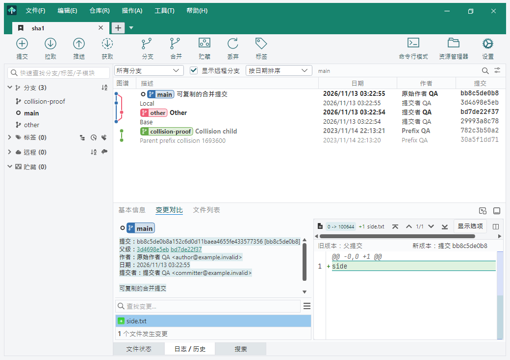
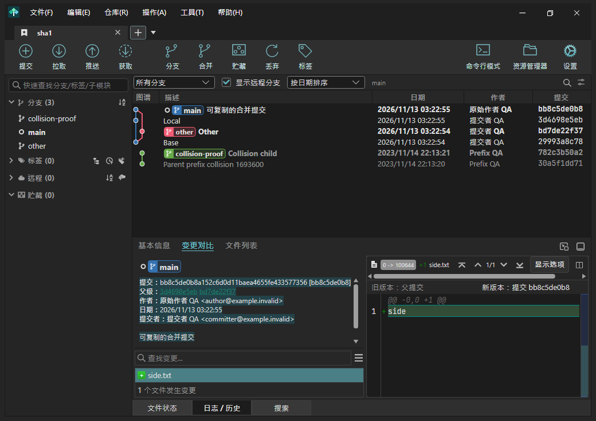
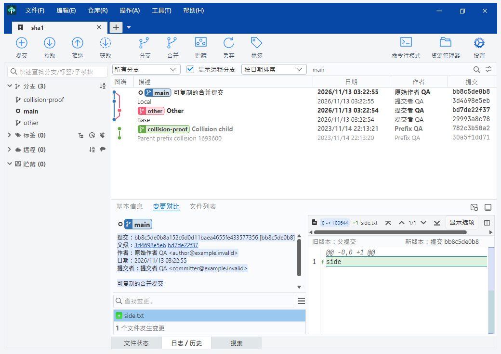
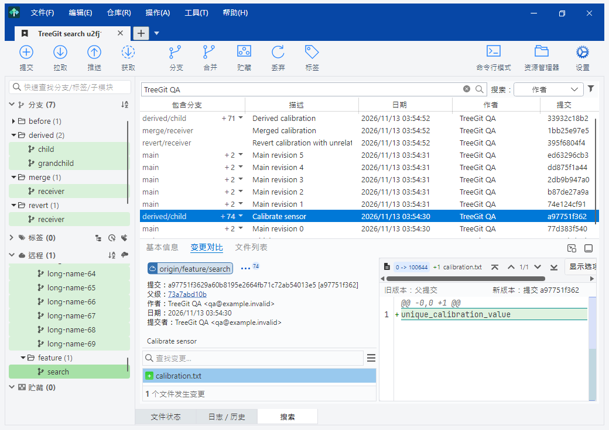
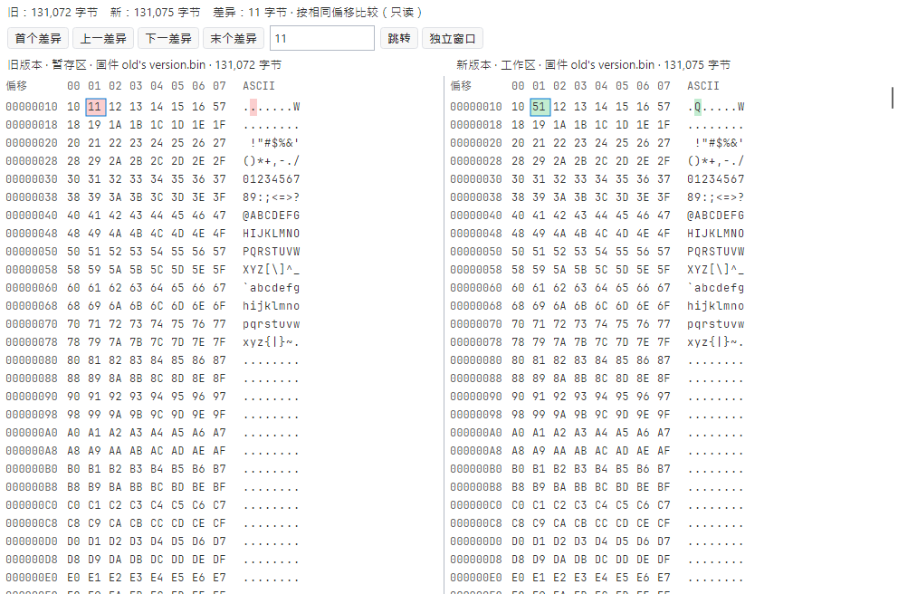
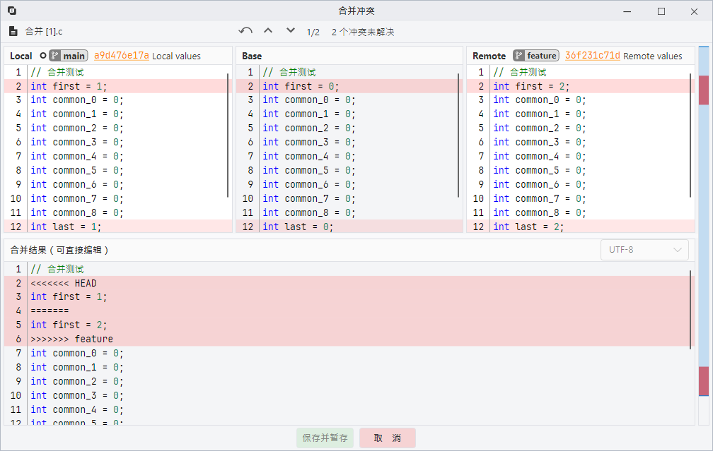
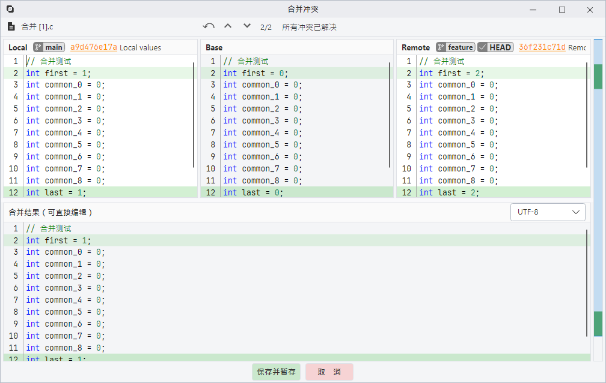

# TreeGit

基于 [SourceGit](https://github.com/sourcegit-scm/sourcegit) 的桌面 Git 客户端，面向工程师日常使用。保留 SourceGit 的 Git 工作流，调整主界面为接近 SourceTree Windows 的布局，并增加让 AI 直接控制软件的 MCP 服务。

**无需安装、无需登录软件账号。** 解压 Windows x64 便携版后运行 `TreeGit.exe`。访问需要授权的 Git 仓库时，使用对应仓库的账号或 SSH 密钥。

**内置二进制文件对比，无需外部工具。** 在 TreeGit 中直接左右对比旧版与新版二进制内容，查看十六进制、ASCII、字节偏移和差异高亮，并跳转前后差异；无需安装 Beyond Compare 等外部比较软件。

> TreeGit 是独立衍生项目，与 Atlassian SourceTree 没有隶属关系。界面和图谱独立实现，不包含 SourceTree 程序或图像资产。SourceGit 原版权和 MIT 许可证保留。

## 界面与功能

保留 SourceGit 的 Git 功能，采用接近 SourceTree Windows 的主界面布局。左侧管理分支、标签、远程和贮藏，底部通过“文件状态”“日志 / 历史”“搜索”三个页签切换工作区与历史内容。

### 近期功能与实际效果

| 功能 | 显示与操作效果 |
| --- | --- |
| 仓库标签与布局 | 标签背景不透明；选中的标签与下方内容区贯通，并显示关闭按钮。仓库较多时可用下拉列表选择。图谱、描述、日期、作者、提交等列可拖动调整宽度，并按仓库保存。 |
| Light / Dark / Blue 主题 | Light 使用深绿色顶栏，Dark 使用深灰色顶栏，Blue 使用蓝色顶栏与浅色内容区；“跟随系统”在 Light、Dark 间自动切换。初次启动默认 Light，升级保留原选择。 |
| 图谱与分支筛选 | 当前检出分支的主线始终在最左侧；提供“当前分支”和“所有分支”。当前分支包含合并历史，勾选“显示远程分支”后也显示对应上游历史；此模式下单击其它分支不会改变图谱范围。 |
| 同步数量与本地改动 | 获取远端信息后，仓库标签及拉取 / 推送按钮显示对应方向与提交数量；本地分支头提交加粗。有本地改动时，图谱顶部显示“未提交的更改”，选中后可查看已暂存、未暂存文件及差异；没有改动时隐藏该节点。未完成的合并在图谱中连接两个父节点。 |
| 提交的分支名框 | “变更对比”信息区顶部显示分支框，样式与历史描述中的分支框一致；旁边“…”右上数字表示其他包含此提交的分支数，点击展开列表。没有其他包含分支时隐藏“…”；无法确认原始分支时，悬停提示说明显示的是推定分支。 |
| 分支联动与高亮 | 选中历史提交或搜索结果后，左栏中包含该提交的分支使用浅底色，详情分支框对应的分支使用较深底色；同一跟踪关系优先突出本地分支，并展开对应分组。手动单击分支使用相同的深色选中效果。 |
| 搜索与历史跳转 | 搜索结果增加“包含分支”列，多分支结果显示数量及下拉箭头。双击结果进入“日志 / 历史”，自动切换为“所有分支 + 显示远程分支”，定位并选中提交。单击左栏任意分支也会返回历史；双击当前本地分支不切换，其他本地分支先确认，远程分支进入检出弹框。 |
| 整块提交信息可复制 | 提交、父级、作者、日期、提交者的名称、值及完整说明可连续拖选、跨行选择、全选和复制。右键可复制选区、全部文本或完整 SHA；后台刷新和主题切换保留当前选区。 |
| 父级 SHA 直接导航 | 提交 SHA 显示为 `完整 SHA [10 位简要 SHA]`。父级首次就显示 10 位，同时查重，有重复再自动扩位，避免先长后短闪现；悬停显示完整值，点击文字跳转，拖选不会误跳转。Light、Dark 下的父级文字均使用 Light 顶栏绿色，Blue 下使用蓝色顶栏同色。 |
| 内置二进制 Diff | 旧版本 / 新版本左右对照，显示十六进制、ASCII、偏移和差异高亮，可跳到前后差异、指定偏移，并打开独立窗口；无需外部比较工具。 |
| 可编辑三方合并 | 上方并排显示 Local / Base / Remote，下方直接编辑合并结果。未解决冲突为红底，解决后变绿；顶栏显示当前冲突序号、总数和剩余数量。右键可选择仅左、仅右或组合顺序，已解决块可复原，顶栏可撤销；“保存并暂存”后关闭窗口。 |
| 后台更新与启动检测 | 勾选“启动时检测软件更新”后，每次启动都会检测。更新窗口提供“后台更新”；下载前或下载 / 校验期间关闭窗口，可选择取消或转入后台。下载完成或失败后重新提示，由用户决定重试或重启安装；支持有效下载片段续传。无新版本或启动检测暂时离线时保持安静。 |
| 启动与便携运行 | 优先加载当前选中的仓库，其余仓库逐步加载；未加载标签也显示正确仓库名。自动使用电脑上可用的 Git，不可用时回退到随包 Git；无需安装 .NET 或登录软件账号。 |
| 仓库认证与 MCP | 各仓库可独立配置凭据；认证使用同一个置顶账号 / 密码窗口，密码可留空，并可切换可见性。MCP 默认完整读写，支持 AI 查询、控制界面及执行 Git 操作，也可选择只读连接。 |

“包含分支”表示提交在 Git 历史中的包含关系，不保证其改动在后续 revert 或人工修改后仍然生效。二进制对比按相同偏移比较，插入 / 删除后的字节不自动重新对齐；图片和 LFS 保留专用视图。“使用外部合并程序查看”当前显示“暂未支持”。

克隆、获取、推拉、分支、标签、合并、变基、交互式变基、贮藏、补丁、文件历史、Blame、子模块、Worktree、GitFlow、LFS、Bisect 和命令日志等功能继续保留；入口见[功能对照](docs/FUNCTIONALITY.md)。使用 TreeGit 自有图标，帮助 / 关于注明 SourceGit 来源及 MCP 支持。

### 实际界面

以下均为 TreeGit 2026.24.2 的真实界面截图，来自隔离测试仓库。仓库、分支、提交、代码、二进制内容及作者均为演示数据；不含用户业务仓库、真实账号、个人路径或凭据。点击图片可查看原图。

**Light / Dark / Blue：主题与整块提交信息选择**

| Light | Dark | Blue |
| --- | --- | --- |
| [](docs/images/ui-2026.24.2/theme-light.png) | [](docs/images/ui-2026.24.2/theme-dark.png) | [](docs/images/ui-2026.24.2/theme-blue.png) |

**包含分支与搜索联动：结果中的数量下拉、详情分支框及左栏高亮**



**内置二进制对比：旧版 / 新版左右显示，不依赖外部工具**



**三方合并：上方比较 Local / Base / Remote，下方编辑合并结果**

| 未解决冲突示例 | 解决后示例 |
| --- | --- |
| [](docs/images/ui-2026.24.2/merge-unresolved.png) | [](docs/images/ui-2026.24.2/merge-resolved.png) |

当前正式版为 **2026.24.2（Windows x64）**，下载见 [Releases](https://github.com/JonSun2020/TreeGit/releases/latest)；近期改动见[发行说明](docs/RELEASE-2026.24.2.md)，实际检查范围及结果见[验收记录](docs/VALIDATION-2026.24.2.md)。后续继续跟随 SourceGit 正式版本更新，保留 TreeGit 自行开发的功能和交互。

## 下载安装

从 [最新正式版](https://github.com/JonSun2020/TreeGit/releases/latest) 下载 [TreeGit-2026.24.2-Windows-x64.zip](https://github.com/JonSun2020/TreeGit/releases/download/treegit-v2026.24.2/TreeGit-2026.24.2-Windows-x64.zip)，完整解压后运行 `TreeGit/TreeGit.exe`。标准包含 Git，约 70 MB。校验值见同页的 `SHA256SUMS.txt`。2026.23.10 及更早版本需先手动升级一次，此后可使用“帮助 → 检查更新”。开发构建仍可从 **Actions → TreeGit Windows portable** 下载。

- 自带裁剪和压缩后的 .NET 运行时，无需安装 .NET。
- 自动优先使用电脑上已有且可用的 Git；没有安装、路径失效或版本不兼容时，自动使用随包的便携 Git，无需另行安装或联网下载。
- 请完整解压并保留 `git/` 目录。内置 MinGit、OpenSSH、OpenSSL、CA 证书、Git LFS 和 Git Flow；组件及许可证见[随包 Git 说明](docs/GIT-COMPONENTS.md)。仍可在偏好设置指定自己的 Git。
- 偏好和缓存保存在旁边的 `data/` 中。复制旧版偏好即可保留个人配置；仓库内的 SourceGit 设置继续兼容。
- 当前发布和主要验收平台为 **Windows x64**。

## 仓库账号与 SSH

每个仓库可以独立配置 HTTPS 账号和密码；认证时在同一个置顶窗口输入账号和密码（密码可留空），右侧眼睛可切换密码明文与 `*`；需要认证、账号缺失或密码失效时弹出输入框。已保存密码使用当前 Windows 用户的系统凭据库，不随便携目录复制。

SSH 使用 OpenSSH，并支持每个远程独立选择私钥。HTTPS 使用 OpenSSL 后端；Git for Windows 自带的 OpenSSH 使用其配套加密组件。SSH 与 OpenSSL 分别承担连接协议和加密支持，不需要把它们作为同一种协议配置。

## MCP：AI 控制软件

在 **工具 → MCP · AI 连接** 复制配置，添加到支持 stdio MCP 的 AI 客户端。默认完整读写，可以查询、控制界面和执行全部 Git 操作。未启动时会自动打开 TreeGit。

```json
{
  "mcpServers": {
    "treegit": {
      "command": "D:\\Tools\\TreeGit\\TreeGit.exe",
      "args": ["--mcp"]
    }
  }
}
```

将路径替换为自己的实际路径。需要只读时，把 `args` 改成 `["--mcp", "--read-only"]`。工具表、调用示例、认证与操作行为见 [MCP 使用说明](docs/MCP.md)。

## 从源码构建

需要 Git、Windows、PowerShell 和 .NET 10 SDK。依赖源码已保存在仓库中。

```powershell
git clone https://github.com/JonSun2020/TreeGit.git
cd TreeGit
./build-treegit.ps1 -Destination ./artifacts/TreeGit
./package-treegit.ps1 -Source ./artifacts/TreeGit -Destination ./artifacts
```

该脚本构建压缩、裁剪的自包含单文件程序，并生成 `data/`、许可证、构建信息和 MCP 配置。内部程序集暂保留 `SourceGit` 名称，以兼容资源和上游代码；对外程序名为 `TreeGit.exe`。

普通开发构建：

```powershell
dotnet build src/SourceGit.csproj -c Release -r win-x64 -p:PublishAot=false
```

构建脚本也支持本机已有的便携 SDK。测试用驱动仅在显式启用 `-IntegrationTests` 时编入，正常发布不包含这些入口。

全部功能的界面位置见 [SourceGit 功能入口对照](docs/FUNCTIONALITY.md)。仓库设置统一为远程仓库与高级两页，完整的原有配置仍可从高级页进入。

## 跟随上游迭代

当前基线为 SourceGit **2026.24**，正式标签 `v2026.24` 对应的 master 提交 `2735a8ad80c2443bc736b7e6e501f1052b61d940`。保留上游提交历史，后续通过独立同步分支合并上游更新，再验证 TreeGit 的界面、认证和 MCP。

具体步骤、依赖兼容边界和需要审查的修改点见 [上游同步维护说明](docs/UPSTREAM.md)。TreeGit 发布使用 `treegit-v...` 标签，与 SourceGit 的版本区分。

## 许可证与贡献

遵循 [MIT](LICENSE)，第三方声明见 [THIRD-PARTY-LICENSES.md](THIRD-PARTY-LICENSES.md)。原版文档保存在 [上游原始 README](docs/UPSTREAM-README.md)。欢迎通过 Issues 报告问题，或通过 Pull Request 改进界面、兼容性和工程师常用工作流。
