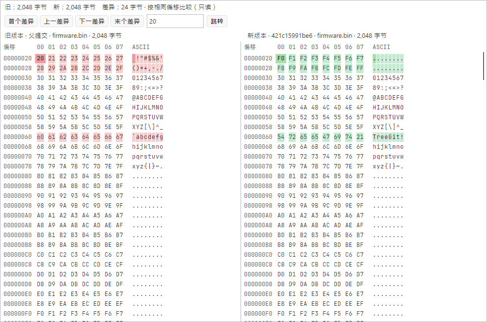

# TreeGit 2026.24.15

## Windows x64 便携包

- **SystemGit** 使用电脑已安装的 Git，适合已有可用 Git 的电脑。
- **BundledGit** 随附 Git、OpenSSH、Git LFS 和 Git Flow，适合离线使用或修复内置 Git。
- 两种包均可解压即用。发行附件 `SHA256SUMS.txt` 提供 SHA-256 校验值。

## 历史列表与工作区

- 拖动历史列表的列分隔线可单独调整左侧列宽。内容超出视口时，底部可横向滚动，左侧图谱保持固定。
- 「显示远程分支」使用当前主题的复选框配色。内置 Git 缺失提示紧跟选项标签，括号和说明文字与标签对齐。
- 暂存和取消暂存按钮统一宽度。列表为空或没有选中文件时，对应按钮会置灰。简体和繁体的取消暂存按钮采用更短的文案。

## 响应与体积

- 打开仓库和完整刷新共用一次全量 Git 配置读取。连续刷新时只应用最新的配置结果。
- 减少读取提交历史和滚动图谱时的重复处理，并加快大批文件选中时的工作区筛选和排序。
- 排除废弃的工具图标，合并字节相同的 JetBrains 图标资源。

## 界面示例

下面是内置固件对比的实机截图。完整图集还展示了分支联动、搜索、三方合并、混合编码和提交区。[查看 2026.24.15 图集](https://github.com/JonSun2020/TreeGit/tree/master/docs/images/ui-2026.24.15)

