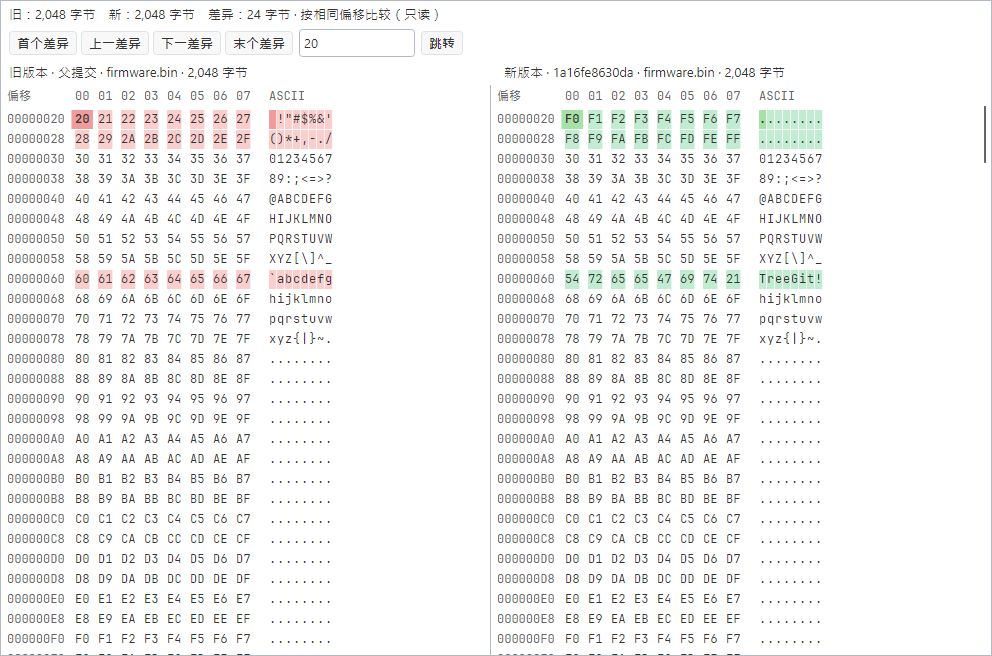
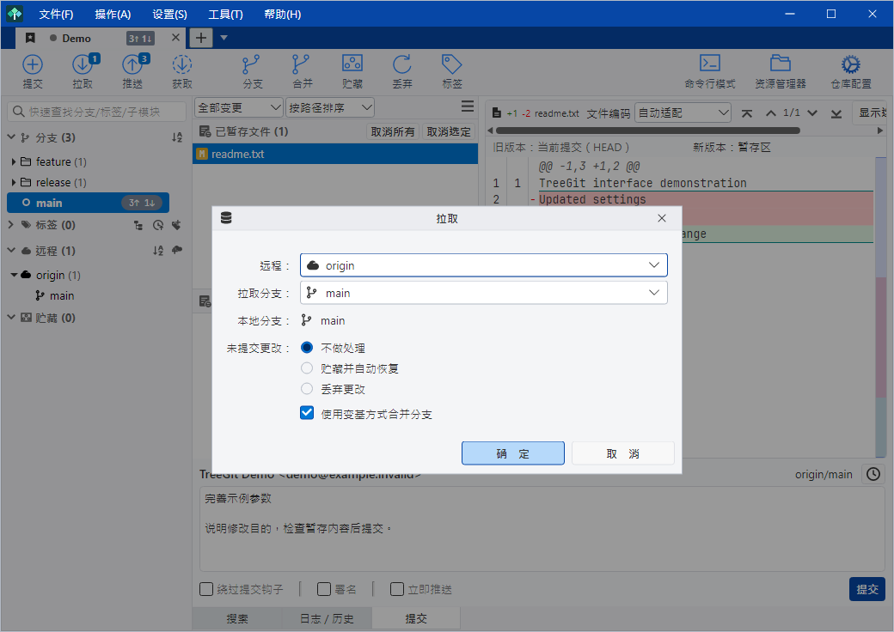

# TreeGit 2026.24.16

## Windows x64 便携包

- **SystemGit** 使用电脑已安装的 Git，下载体积较小。
- **BundledGit** 随附 Git、OpenSSH、Git LFS 和 Git Flow，可在没有 Git 的电脑上使用。
- 两种包解压后均可直接运行，校验值见发行附件 `SHA256SUMS.txt`。

## 认证和远程操作

- HTTPS 认证按远程地址匹配可用方式。GitHub 显示个人访问令牌的输入和获取入口。
- 认证失败后保留账号、密码或令牌输入。按实际结果区分凭据被拒、仓库权限不足、仓库不可访问和服务器异常。
- 密码取消遮挡后，焦点移回输入框仍能看到内容。长令牌可以在固定宽度的输入框内滚动查看。

## 界面和搜索

- 搜索方式下拉框收起后显示所选方式，宽度随当前语言调整。复选框和输入框沿用统一样式，历史中的变更查找图标在输入框右侧。
- 拉取、推送、获取、创建分支和贮藏等弹窗按当前语言对齐。分支和推送的风险提示预留高度，未启用时以浅灰斜体显示，启用后的「注意」为红色粗体。
- 创建分支时可选择是否切换。停留在原分支时，「未提交更改」及其选项以同一浅灰显示并停用。在高缩放下，展开的分支列表与输入框边缘对齐。

## 运行效率

- 欢迎页仅查询已显示的仓库状态，滚动或展开分组时按需读取。在包含 39 个仓库的测试清单中，初次进入欢迎页的 Git 状态查询从 39 次减为 3 次。
- 无可用远程或关闭自动获取时停止轮询。减少了启动和刷新时的重复 Git 配置查询及分支归属计算。
- 仓库状态逐行读取。关闭或切换视图时，可取消未完成的状态、图片和子模块差异查询。

## 界面示例

正式便携包的演示图集展示了固件字节对比、提交和分支联动、搜索结果、可编辑三方合并、混合编码、提交页和拉取弹窗。截图使用虚构仓库。 [查看 2026.24.16 图集](https://github.com/JonSun2020/TreeGit/tree/master/docs/images/ui-2026.24.16)

